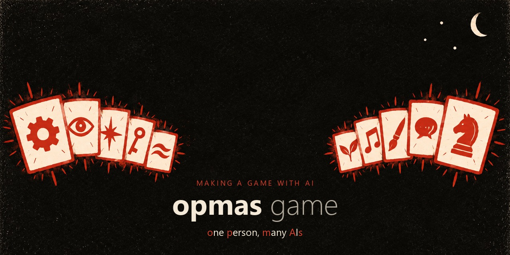

# 用 AI 做游戏

[](https://github.com/opmasgame/making-a-game-with-ai/actions/workflows/tests.yml)

视频系列《用 AI 做游戏》的配套工具和模板。作者 **opmas game**：一个人，和一群 AI。我一个人带着 Claude Code、Codex 和别的 AI 工具做一款多人卡牌游戏《缄默都会》，每一集都用真实的对话记录、提交和测试报告来讲，翻车的地方也照讲。

这里的每个文件夹都来自一次翻车，而且不只适用于我们的游戏，也不只适用于游戏：每个工具就是一个 Python 文件，只用标准库，在 Linux 和 Windows 上都测过。

## 能解决什么

| 你遇到的问题 | 用什么 | 出自 |
|---|---|---|
| 数据指向不存在的东西：代码不认识的枚举值、没人定义的变量……而且什么都不崩 | [`refcheck.py`](ep01-silent-failure-checklist/README.zh.md)：查每一处引用，对不上就拒绝往下走 | [第 1 期](ep01-silent-failure-checklist/README.zh.md) |
| 机器人或试玩跑完报「0 错误」，可你说不清游戏里哪些部分从没发生过 | [`action_coverage.py`](ep01-silent-failure-checklist/README.zh.md)：把设计过的每个行动分进四个桶 | [第 1 期](ep01-silent-failure-checklist/README.zh.md) |
| AI 说「修好了，加了测试，全绿」 | [`prove_test_fails.py`](ep01-silent-failure-checklist/README.zh.md)：把修复拿掉，确认测试会变红 | [第 1 期](ep01-silent-failure-checklist/README.zh.md) |
| 分不清设计里哪些是你定的、哪些是 AI 顺手写的 | [`CLAUDE.md`、`AGENTS.md`、ADR 和设计文档模板](ep02-agent-rules-templates/README.zh.md)，带【已定】/【提案】标记 | [第 2 期](ep02-agent-rules-templates/README.zh.md) |
| AI 自己把提案标成了已定 | [`doc_guard.py`](ep02-agent-rules-templates/README.zh.md)：Claude Code 钩子，直接拦下 | [第 2 期](ep02-agent-rules-templates/README.zh.md) |

## 试一下

```bash
git clone https://github.com/opmasgame/making-a-game-with-ai
cd making-a-game-with-ai/ep01-silent-failure-checklist
python refcheck.py demo/refcheck/spec.json
python action_coverage.py --actions demo/coverage/actions.csv demo/coverage/events.jsonl
```

两个演示都会把埋在一个小游戏里的坑找出来。要在自己的项目里用，把对应的那一个文件拷过去就行。

## 各期

| 期 | 标题 | 文件 |
|---|---|---|
| 1 | AI 写的游戏零报错，可一半是死的 | [`ep01-silent-failure-checklist/`](ep01-silent-failure-checklist/README.zh.md) |
| 2 | 我只问了 AI 一句：这是你自己想的吗？ | [`ep02-agent-rules-templates/`](ep02-agent-rules-templates/README.zh.md) |
| 3 | 我请了 30 个 AI 玩家，首富周一就不玩了 | — |
| 4 | 我游戏里的每张图都是 AI 画的，有个人长了三只手 | — |
| 5 | 真人一局都没打完，我的 AI 已经打了将近两千局 | — |
| 6 | AI 测试全绿，我自己玩了一局：太复杂了 | — |
| 7 | 我问 AI：你是不是不能做这个工作？ | — |
| 8 | 八天，AI 用掉五千美元的 token，98% 是在重读 | — |
| 9 | 和 AI 做游戏：给一千人设计的城，最后砍到九个人 | — |
| 10 | AI 凭感觉做了四版预告片样片，全被我否了 | — |

视频在 B 站搜「opmas game」。旁白是 AI 配音。

## 跑测试

```bash
python -m unittest discover -s ep01-silent-failure-checklist/tests
python -m unittest discover -s ep02-agent-rules-templates/tests
```

发现 bug，或者哪个工具判错了？开一个 issue，附上能复现的输入。

---

《缄默都会》即将登陆 Steam，愿望单：https://store.steampowered.com/app/5503450/?utm_source=github

代码：MIT。`ep02-agent-rules-templates/` 里的模板：CC0。

English: [README.md](README.md)
